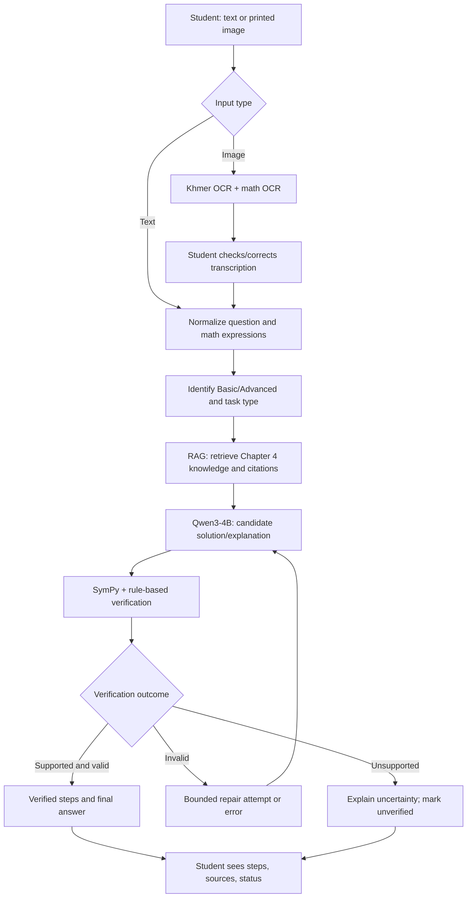
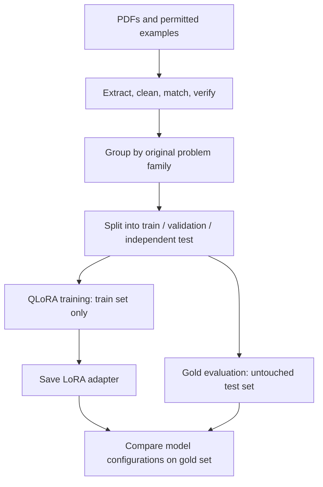

# KhmerMath AI

**A Bilingual Grade 12 Integral Solver and Proof Assistant for Cambodia**

> **Course:** Advanced Programming for Data Science  
> **Academic project:** Group 5 · 5 team members · 7 weeks  
> **Current scope:** Grade 12 **Chapter 4 — Integrals (អាំងតេក្រាល)**, **Basic Level** and **Advanced Level**  
> **Long-term vision:** Extend the same platform to every chapter of both textbooks.

## 1. Project overview

KhmerMath AI is a web application that helps Grade 12 students understand and solve mathematics exercises in **Khmer or English**. Students can **type a question** or **upload a printed exercise image**. The application retrieves relevant curriculum material, produces a step-by-step candidate solution, checks supported mathematical operations, and shows the explanation with its verification status and textbook source.

Our academic contribution is **not just a chatbot interface**. We will measure how **QLoRA fine-tuning**, **retrieval-augmented generation (RAG)**, and **symbolic mathematics (SymPy)** change answer correctness and teaching quality compared with a base language model.

### Goals for the 7-week submission

- [ ] Support **Basic** and **Advanced** Chapter 4 material as separate curriculum levels.
- [ ] Support **Khmer** and **English** questions and explanations.
- [ ] Solve selected **indefinite and definite integrals** with understandable steps.
- [ ] Assist with **selected integral identities and properties**; clearly label unverified proof steps.
- [ ] Accept **typed questions** and **printed exercise images** (with editable OCR transcription).
- [ ] Retrieve formulas, definitions, and worked examples with **page-level citations**.
- [ ] Symbolically verify supported answers and transformations with **SymPy**.
- [ ] Run a **Qwen3-4B QLoRA** experiment on a **Google Colab T4**.
- [ ] Compare the model configurations on a **held-out, manually reviewed test set**.
- [ ] Deliver working UI/API, reproducible code, demonstration, evaluation, and final report.

**Out of scope for this deadline:** all 15 chapters, guaranteed correctness for every integration technique, general formal theorem proving, unrestricted handwritten/diagram OCR, and production-grade scaling. The repository and data format will support these later.

---

## 2. Collected source documents

The provided `data.zip` already contains the **two complete textbooks** and **chapter-by-chapter answer keys**. For this release, only Chapter 4 content is processed and evaluated.

| Source | Pages in supplied PDF | How we use it |
| --- | ---: | --- |
| `Course_book_Basic_Level.pdf` | 257 | Identify and extract its Chapter 4 lessons, formulas, examples, exercises |
| `Course_book_High_Level.pdf` | 257 | Identify and extract its Chapter 4 content at Advanced Level |
| `Answer_key_book/Basic_Level/Chapter4.pdf` | 72 | Candidate worked solutions for Basic Level |
| `Answer_key_book/High_Level/Chapter4.pdf` | 35 | Candidate worked solutions for Advanced Level |

**Known data issues:** Both textbook PDFs contain Khmer text that looks correct on the page but extracts with **legacy-font/encoding corruption**. Some formulas are also difficult to parse automatically. The sampled Chapter 4 answer keys have more usable text, but **their solutions must still be matched to the exact exercise and checked**; an answer key is not automatically a verified training record.

**Source-use rule:** Record provenance and licensing for each source. Do not publish raw textbook PDFs, substantial extracted textbook content, or answer keys in a public GitHub repository unless redistribution is authorized.

---

## 3. End-to-end architecture



**Important:** The repair loop is limited (for example, one retry); otherwise the system returns an honest failure or `unverified` status. **Numerical checks alone do not constitute a proof.** The model must never execute arbitrary generated Python code.

### Training pipeline (offline)



### Technologies

| Layer | Planned tool | Purpose |
| --- | --- | --- |
| Frontend | Next.js + TypeScript + Tailwind CSS + KaTeX | Responsive bilingual math UI |
| API | Python + FastAPI + Pydantic | Validate requests and orchestrate services |
| Base model | Qwen3-4B | Generate candidate steps and explanations |
| Training | QLoRA + PEFT / TRL or Unsloth | Parameter-efficient supervised fine-tuning |
| Retrieval | BGE-M3 + ChromaDB | Search bilingual curriculum snippets |
| Math checker | SymPy + explicit rule checks | Verify supported operations and domain restrictions |
| PDF / OCR | PyMuPDF + tested Khmer/math OCR | Extract text, formulas, and printed exercises |
| Hardware | Google Colab T4 | Pilot fine-tuning and evaluation |
| Deployment | Docker Compose | Reproducible course demonstration |

---

## 4. Repository structure

The structure below is the **target layout**. On Day 1, create only the repository, `data/raw/`, `data_pipeline/`, `docs/`, and the baseline setup. Remaining files are added as each workstream progresses.

```text
khmermath-ai/
├── README.md
├── .gitignore
├── .env.example
├── docker-compose.yml                  # created later
├── data/
│   ├── raw/                             # supplied PDFs; DO NOT commit without permission
│   │   ├── Course_book/
│   │   │   ├── Course_book_Basic_Level.pdf
│   │   │   └── Course_book_High_Level.pdf
│   │   └── Answer_key_book/
│   │       ├── Basic_Level/Chapter4.pdf  # other chapters may remain locally
│   │       └── High_Level/Chapter4.pdf
│   ├── intermediate/                    # extracted pages, OCR, manual fixes
│   ├── processed/chapter_04/
│   │   ├── basic/                        # lessons, examples, exercises
│   │   └── advanced/
│   ├── rag/chapter_04/                   # chunk metadata; vectors built from it
│   ├── instruction/                     # train.jsonl / validation.jsonl
│   └── evaluation/                      # held-out gold math/proof/OCR sets
├── data_pipeline/
│   ├── audit_pdfs.py
│   ├── extract_chapter.py
│   ├── recover_khmer.py
│   ├── extract_math.py
│   ├── match_exercises.py
│   ├── build_datasets.py
│   └── validate_records.py
├── ml/
│   ├── notebooks/                       # Colab T4 experiments
│   ├── training/                        # QLoRA scripts/configs
│   ├── inference/                       # model loader and prompt templates
│   └── evaluation/                      # metrics and system comparison
├── backend/
│   ├── app/
│   │   ├── main.py
│   │   ├── api/                          # solve, proof, OCR, topics
│   │   ├── schemas/                      # request/response models
│   │   └── services/                     # RAG, LLM, solver, proof, OCR
│   └── tests/
├── frontend/
│   └── src/
│       ├── app/                          # student pages
│       ├── components/                   # question, result, sources
│       └── lib/                          # API client, types
├── tests/                               # end-to-end tests
├── docs/
│   ├── data_dictionary.md
│   ├── chapter4_inventory.csv
│   ├── annotation_guidelines.md
│   ├── architecture.md
│   └── experiment_results.md
└── scripts/                             # reusable commands, created later
```

Add new chapters under `data/processed/chapter_XX/{basic,advanced}/`. **Do not hardcode Chapter 4 into the reusable processing logic**; pass chapter and level as configuration values.

---

## 5. Step-by-step development workflow

### Phase 1 — Prepare and validate the data (Weeks 1–2)

1. **Inventory the PDFs.** Record file names, page counts, checksums, permissions, and which printed/PDF pages belong to Chapter 4.
2. **Compare extraction methods.** Test direct PyMuPDF extraction versus recovering legacy Khmer font mappings. Use OCR only for pages or regions that cannot be recovered reliably.
3. **Preserve mathematical notation.** Store equations as LaTeX and check fractions, powers, integral bounds, differentials, and constants of integration.
4. **Split into units.** Separate definitions, formulas, theorems, worked examples, and exercises; retain textbook edition, level, chapter, and source page.
5. **Match exercises with solutions.** Match based on the actual mathematical question, not just page or exercise numbers; flag unmatched records for review.
6. **Verify a small sample first.** Start with **20–30 diverse records across both levels**. Every item needs a readable question and correct reference solution.
7. **Create a data-quality gate.** Require valid Unicode Khmer, valid/visually checked LaTeX, traceable sources, and verified mathematical answers before creating training records.
8. **Split by problem family before augmentation.** Place translated, paraphrased, and numerically varied siblings in the same split to avoid leakage.

**Outputs:** `lessons.jsonl`, `formulas.jsonl`, `exercises.jsonl`, `chunks.jsonl`, `train.jsonl`, `validation.jsonl`, and an independent held-out set.

> **Do not start fine-tuning until the initial dataset passes manual checks.**

### Phase 2 — Build a baseline solver and RAG (Weeks 2–3)

1. Create a FastAPI `POST /api/v1/solve` endpoint with structured input/output.
2. Load a pretrained Qwen3-4B model and record the baseline on a small development set.
3. Build a Chapter 4 ChromaDB index using BGE-M3, with level and page metadata.
4. Retrieve definitions, formulas, and worked examples for each question.
5. Use SymPy to check supported indefinite/definite integrals, including constants and domains.
6. Return candidate steps, citations, and **explicit verification status**.
7. Test Basic and Advanced questions in both Khmer and English.

**Exit gate (end of Week 3):** A user can type a supported Chapter 4 problem and receive readable steps, textbook references, and a defensible verification status.

### Phase 3 — Fine-tune and compare (Week 4)

1. Convert reviewed question/solution pairs into a consistent instruction format.
2. Test Qwen3-4B + 4-bit QLoRA on **Google Colab T4** with a small pilot run.
3. Use conservative sequence length, micro-batch size, and gradient accumulation; save checkpoints outside the temporary Colab runtime.
4. Track model ID/revision, seed, data version, training configuration, losses, and GPU usage.
5. Compare baseline versus fine-tuned model on the **same** held-out questions and decoding settings.
6. Keep the fine-tuned adapter only if results justify its inclusion; document any regression honestly.

**Output:** LoRA adapter, reproducible notebook/scripts, experiment logs, and initial evaluation.

### Phase 4 — Image input, proof assistant, and web UI (Week 5)

1. Add image upload and extract printed Khmer text and mathematical expressions.
2. **Show OCR transcription for student confirmation or correction** before solving.
3. Create a Basic/Advanced selector, Khmer/English selector, question editor, and step-by-step result view.
4. Add selected integral-identity/property explanations and a checker for the steps it truly supports.
5. Show `verified`, `invalid`, or `unverified` outcomes instead of overstating certainty.
6. Display textbook citations with document name, chapter, and page number.

**Output:** End-to-end student demo with text and image input.

### Phase 5 — Evaluation and hardening (Week 6)

1. Freeze the independent test set (no tuning or prompt changes based on test answers).
2. Compare: **A** prompted base, **B** fine-tuned, **C** fine-tuned + RAG, **D** fine-tuned + RAG + SymPy.
3. Score final-answer correctness, step validity, proof soundness, retrieval relevance, Khmer/English clarity, OCR quality, and response time.
4. Separate results by **Basic vs Advanced** and **Khmer vs English**.
5. Have two reviewers assess sampled explanation quality and proof completeness; report agreement.
6. Add input limits, bounded retries, timeout handling, and regression tests for known failures.

**Output:** Reproducible evaluation report with both successes and failures.

### Phase 6 — Academic delivery (Week 7)

1. Freeze code, data versions, model revision, and trained adapter.
2. Run smoke tests and the most important end-to-end test cases.
3. Package backend/frontend; add Docker when the core demo is already working.
4. Prepare a demo showing Basic Khmer text, Advanced English text, image OCR correction, and verification.
5. Complete the technical report, presentation, contribution summary, limitations, and future-chapter plan.

**Output:** source code, evaluation, trained adapter or documented baseline decision, working demonstration, and presentation.

---

## 6. Data format and quality rules

Each problem should have an original *problem family* ID. Example below is **team-authored illustration**, not claimed to be taken from a textbook:

```json
{
  "problem_id": "B_C04_EX_0001",
  "family_id": "FAM_INT_POWER_001",
  "grade": 12,
  "level": "basic",
  "chapter_id": 4,
  "topic": "indefinite_integrals",
  "task_type": "solve",
  "question_km": "រកអាំងតេក្រាលនៃ 2x តាម x",
  "question_en": "Find the indefinite integral of 2x with respect to x.",
  "question_latex": "\\int 2x\\,dx",
  "answer_latex": "x^2+C",
  "solution_steps": [
    {
      "latex": "\\int 2x\\,dx=x^2+C",
      "reason": "Power rule for integration"
    }
  ],
  "verification": {
    "status": "symbolically_verified",
    "method": "differentiate_candidate"
  },
  "source": {
    "type": "team_authored",
    "document": null,
    "pdf_page": null
  },
  "review_status": "reviewed",
  "split": "train"
}
```

**Review checklist for each record:** question copied correctly; Khmer readable; formula/bounds correct; answer respects domains and `+C` where necessary; steps logically valid; source traceable; bilingual explanations checked; no duplicate family crosses train/validation/test.

For RAG, index the **lesson/formula/example material**, not the held-out test answers. Keep retrieval content and evaluation data isolated to prevent answer leakage.

---

## 7. API contract (planned)

### `POST /api/v1/solve`

Request:

```json
{
  "question": "\\int (3x^2+2x)\\,dx",
  "level": "basic",
  "language": "en",
  "mode": "step_by_step"
}
```

Response outline:

```json
{
  "topic": "indefinite_integrals",
  "steps": ["Apply the integration power rule to each term."],
  "answer_latex": "x^3+x^2+C",
  "verification_status": "symbolically_verified",
  "verification_detail": "Derivative equals the integrand.",
  "sources": [
    {"document": "Course_book_Basic_Level.pdf", "chapter": 4, "pdf_page": null}
  ]
}
```

The sample source page is `null` intentionally: **never invent a textbook citation**. Real responses must use a page actually retrieved from the knowledge base.

Other planned endpoints: `POST /api/v1/ocr`, `POST /api/v1/proof/check`, `GET /api/v1/topics`, and `GET /health`.

Verification statuses should distinguish **symbolically_verified**, **invalid**, and **unverified**. A mathematically plausible narrative is not automatically a verified proof.

---

## 8. Roles and 7-week ownership

| Team member | Primary responsibility | Must coordinate with |
| --- | --- | --- |
| 1 — Data lead | PDF extraction, legacy Khmer handling, exercise/solution matching, annotations | Math lead and AI lead |
| 2 — AI lead | Qwen3-4B baseline, QLoRA fine-tuning, model evaluation | Data lead and backend lead |
| 3 — RAG / math lead | Retrieval, SymPy, proof rules, mathematical verification | Data lead and backend lead |
| 4 — Backend lead | FastAPI, schemas, orchestration, API tests | AI lead and frontend lead |
| 5 — Frontend / OCR lead | Next.js, equation rendering, image upload, OCR confirmation | Backend lead and data lead |

**All members** review a share of the gold set, test integration, review pull requests, and contribute to the final report. Assign one member to coordinate merges and milestones.

### Weekly checkpoint

| Week | Minimum checkpoint |
| --- | --- |
| 1 | Repo ready; Chapter 4 page boundaries verified; first 20–30 high-quality records |
| 2 | Clean data pipeline; first RAG index; SymPy unit tests |
| 3 | Working bilingual text-input solver with real citations |
| 4 | QLoRA run, saved adapter, baseline comparison |
| 5 | OCR correction flow, proof support, integrated frontend |
| 6 | Held-out evaluation and bug fixes |
| 7 | Stable demo, Docker/reproducibility, slides and report |

---

## 9. Getting started — **do this first**

These instructions target **Windows + Git Bash**, but the Python steps also work on other systems with small shell changes. Commands in this section create the workspace and inspect inputs; **training, API, and frontend commands will only work after those modules have been implemented**.

### Step 1 — Create the project directory and Git repository

```bash
mkdir khmermath-ai
cd khmermath-ai
git init
mkdir -p data/raw data/intermediate data/processed/chapter_04/basic
mkdir -p data/processed/chapter_04/advanced data/rag/chapter_04
mkdir -p data/instruction data/evaluation data_pipeline docs
```

Place this `README.md` at the repository root.

### Step 2 — Copy and extract `data.zip`

Copy the supplied `data.zip` **into the project root**, then run:

```bash
python -m zipfile -e data.zip .
```

The archive already contains a `data/raw/` prefix, so this should create:

```text
data/raw/Course_book/Course_book_Basic_Level.pdf
data/raw/Course_book/Course_book_High_Level.pdf
data/raw/Answer_key_book/Basic_Level/Chapter4.pdf
data/raw/Answer_key_book/High_Level/Chapter4.pdf
```

Other answer-key chapters will also be extracted; keep them for future use but **do not process them in the seven-week scope**.

### Step 3 — Add `.gitignore` **before your first commit**

Create a `.gitignore` containing at least:

```gitignore
.venv/
__pycache__/
*.py[cod]
.env
.env.*
!.env.example
.ipynb_checkpoints/
data.zip
data/raw/
data/intermediate/
data/processed/
data/rag/
data/instruction/
data/evaluation/
models/
checkpoints/
chroma_db/
*.safetensors
```

Commit **scripts, schemas, annotation guides, and documentation**, but keep source PDFs and large generated data private until permissions and release rules are decided. Small metadata-only evaluation fixtures may be committed separately when allowed.

### Step 4 — Create a local Python environment

```bash
python -m venv .venv
source .venv/Scripts/activate  # Git Bash on Windows
python -m pip install --upgrade pip
python -m pip install pymupdf sympy pandas tqdm
```

On Linux/macOS use `source .venv/bin/activate` instead. Additional ML/OCR/backend packages are installed in their respective phases, not all on Day 1.

### Step 5 — Run a quick PDF sanity check

```bash
python -c "import pymupdf; p='data/raw/Course_book/Course_book_Basic_Level.pdf'; d=pymupdf.open(p); print('Pages:', len(d)); print('Sample:', repr(d[5].get_text()[:250]))"
```

Repeat with the Advanced textbook. **Expected observation:** the sample may contain corrupted Khmer characters even though the visible PDF page looks fine. Record the result; do **not** push this raw output into an embedding model.

### Step 6 — Create `docs/chapter4_inventory.csv`

Use the following columns:

```csv
level,document,chapter_start_pdf_page,chapter_end_pdf_page,section_title,extractable_khmer,formula_quality,notes
```

Open both textbooks and **manually confirm the Chapter 4 PDF-page boundaries** (PDF page numbers can differ from printed page labels). Also inventory the Chapter 4 answer-key pages. Mark extraction quality as pass/fail for at least five representative pages per document.

### Step 7 — Build your first 20–30 verified exercise records

- Choose examples from **both levels** and **multiple integral types**.
- Manually transcribe the question and solution where automated extraction is unreliable.
- Preserve original question, bilingual explanation, mathematical LaTeX, source page, and validation method.
- Verify supported results using differentiation or symbolic integration; **manually review intermediate reasoning**.
- Group related problem variants under `family_id`.
- Save an initial private JSONL sample for the team to review.

**Week 1 definition of done:** the repository exists, PDFs are located and inventoried, the Khmer extraction problem is documented, the Chapter 4 boundaries are verified, and 20–30 high-quality math records can be loaded and inspected as structured data.

**Do not begin full fine-tuning or mass OCR before this checkpoint.**

---

## 10. Evaluation plan

| System | Configuration | What it tests |
| --- | --- | --- |
| A | Prompted base Qwen3-4B | Strong baseline |
| B | QLoRA fine-tuned Qwen3-4B | Fine-tuning contribution |
| C | Fine-tuned model + RAG | Retrieval contribution |
| D | Fine-tuned model + RAG + SymPy | Independent checking contribution |

Use **the same held-out test problems** and record decoding settings, model revision, data version, and inference latency.

Report at least:

- Final-answer accuracy and 95% confidence interval.
- Step validity and verification coverage (**verified / invalid / unverified**).
- Separate Basic/Advanced and Khmer/English results.
- Retrieval Recall@K and correct textbook citations.
- Human-rated Khmer/English explanation clarity.
- Proof soundness/completeness assessed independently of final-answer accuracy.
- OCR transcription performance on labeled exercise images.
- Common failure modes and examples of unsupported problems.

**Pilot first, scale later:** A reasonable initial development target is **20–30 verified records in Week 1**, then progressively expand the training corpus while reserving a genuinely unseen gold evaluation set. Data quality is more important than artificially reaching a large count.

---

## 11. Definition of a successful final demo

The final presentation should demonstrate:

1. A student selects **Basic**, enters an indefinite integral in **Khmer**, and receives clear steps and sources.
2. A student selects **Advanced**, enters a definite integral in **English**, and receives a checked result.
3. A student uploads a **printed exercise image**, corrects the OCR transcription, and solves it.
4. The proof checker explains a **selected integral property**, with honest verification labeling.
5. The team shows **A/B/C/D comparison results** on independent data and explains what improved or failed.

After the academic submission, add new chapters by reusing the same extraction schema, retrieval metadata, solver interfaces, and evaluation framework. **Do not retrain or rebuild the entire platform just to add a new chapter.**

---

## 12. Immediate next action

> **Start with Step 1 through Step 6 in Section 9. Then prepare 20–30 manually verified Chapter 4 examples in Step 7.**
>
> The first engineering deliverable is **a reliable dataset pipeline**, not fine-tuning, not the final UI, and not all 15 chapters.

**Project status:** Planning and source audit completed; implementation not yet started.
